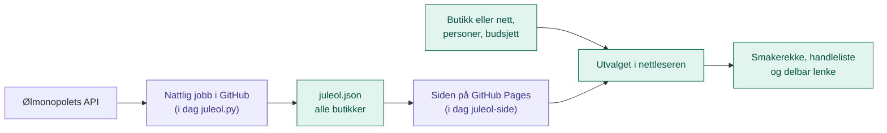

# Task 001: Planlegger for ølsmaking

## Metadata

| Field | Value |
|-------|-------|
| Status | in-progress |
| Created | 2026-11-12 |
| Completed | - |

## Kort fortalt

En side der man velger butikk eller nettbestilling, antall personer og budsjett, og får en smakerekke med
juleøl på tvers av smaksgrupper, fra lett til tungt, med antall flasker, handleliste og en lenke som kan
deles. En jobb i GitHub henter data fra Ølmonopolet hver natt og publiserer siden på GitHub Pages, og
utvalget regnes ut i nettleseren. Dagens skript blir hentejobben, og den håndplukkede rekka blir et
automatisk utvalg. Egen henting fra Untappd, handlekurv hos Polet og alt i Knowits navn er utenfor.
Rundt 1,75 timer.

## Utgangspunktet

Det vi har i dag: `juleol.py` henter juleøl på lager i én butikk, `lag_side.py` fyller
`juleol-side.mal.html` med et håndplukket utvalg, og siden er publisert som en privat side på claude.ai.

| | I dag | Etter denne tasken |
|---|---|---|
| Utvalget | Åtte øl valgt for hånd i `lag_side.py` | Regnes ut fra budsjett og antall personer, med bytter per plass |
| Butikk | Trondheim Torg | Alle 354 butikker som har juleøl, eller nettbestilling |
| Budsjett | Ingen, bare en sum (1 155 kr for fem) | Øvre grense i kroner |
| Data | Skriptet kjøres for hånd, tre kall | Nattlig jobb, ett kall |
| Publisering | Claude må publisere på nytt | Oppdateres selv hver natt |
| Hvem kan bruke den | De den er delt med | Alle med lenken, og koden er offentlig |

Målt 12.11.2026 mot `api.olmonopolet.app`:

| | |
|---|---|
| Juleøl i år, øl og alkoholfritt | 308 |
| Butikker med juleøl på lager | 354 |
| Juleøl med lager i alle butikker, ett kall | 1,4 MB, under 0,2 MB komprimert, 3 sekunder |
| Kan bestilles på nett | 133 av 308, og 9 av dem finnes ikke i noen butikk |
| Smaksgrupper med øl som har score, Trondheim Torg | 11, medregnet alkoholfritt |
| Lageret | oppdateres én gang i døgnet, om kvelden |
| Aktive øl totalt, hvis vi tar med alt øl | 2 215 |

API-et svarer uten nøkkel, men har krav om nøkkel klart i koden og kan slå det på. Scoren deres kommer fra
Untappds nettsider, ikke fra en avtale med Untappd.

## Description

### 1. Repoet og arbeidsmåten

- Offentlig repo `olsmaking` på GitHub, lokalt i `~/src/olsmaking`, med koden fra i dag som utgangspunkt.
  Hobbyprosjekt, ikke i Knowits eller DiBKs navn.
- `CLAUDE.md` med hva prosjektet er, kommandoene og reglene under «Rammer».
- `tasks/` med `_TEMPLATE.md` fra mikrodig, og denne planen som task 001.
- Skills fra mikrodig, tilpasset stiene i dette repoet: `ny-task` (nummeret er høyeste i `tasks/` pluss
  én), `plan-kritikk` som den er, og `review-etter-risiko` med en kort tabell der hentejobben får en
  modell-review fordi den sender kall til en annen tjeneste, og resten dekkes av testene.
- `tools/verifiser.sh` kjører JavaScript-testene med `node --test` og Python-testene med
  `python3 -m unittest`, uten andre avhengigheter.

### 2. Nattlig henting

- `juleol.py` blir hentejobben. Den gjør ett kall med lager i alle butikker og skriver `data/juleol.json`
  (under 0,4 MB): for hvert øl navn, varenummer, smaksgruppe, stil, score, innsjekker, alkohol, volum, pris,
  lenker, om det kan bestilles på nett (feltet `post_delivery`), og antall på lager per butikk.
- Butikkene identifiseres med hele navnet, for eksempel «Bodø, Sentrum». API-et gir ikke butikknummeret i
  dette kallet, og fem butikker heter «Sentrum».
- Fila får tidspunktet jobben kjørte. Kallet gir ikke tidspunktet for lageret i hver butikk.
- Mjød og sider holdes utenfor. Alkoholfritt beholdes som egen gruppe.
- Jobben stopper med feil ved svar 401 eller 403, ved færre enn 100 juleøl og ved færre enn 300 butikker,
  slik at siden beholder forrige data i stedet for å bli tom eller halv. Ved 429, serverfeil eller
  tidsavbrudd prøver den én gang til etter fem minutter.
- Krever API-et nøkkel, leser jobben den fra `OLMONOPOLET_API_KEY` (en hemmelighet i GitHub) og sender den
  i `X-API-Key`.
- Kallene sier hvem de kommer fra (prosjektnavn og adressen til repoet i User-Agent).
- `lag_side.py`, det håndplukkede utvalget, CSV-ene og `juleol-side.html` fjernes. Siden på claude.ai blir
  stående, men oppdateres ikke lenger.

### 3. Utvalget

En funksjon i JavaScript uten tilgang til siden, så den kan testes for seg:

- **Kandidater:** i en butikk, øl med minst to flasker mer på lager enn rekka trenger, fordi lageret kan
  være et døgn gammelt. Ved nettbestilling, øl som kan bestilles på nett, uten sjekk av lager.
- **Mengder:** som i dag, rundt 7 cl per øl og person, og 5 cl av øl på 10 % eller mer. Det gir antall
  flasker per øl, og dermed prisen for hele rekka.
- **Score:** Untappd-snittet, trukket mot snittet i smaksgruppa når ølet har få innsjekker, så et øl med
  20 innsjekker og 4,3 ikke slår et med 5 000 og 4,1. Øl uten score er ikke med, og dermed heller ikke
  gruppa «Annet», som bare har øl uten score.
- **Valget:** det settet som gir høyest samlet score, med høyst ett øl per smaksgruppe og totalpris
  innenfor budsjettet. Prisene rundes opp til hele kroner, så alle kombinasjoner kan prøves systematisk på
  under et sekund, og rekka går aldri over budsjettet.
- **Antall øl:** åtte som standard, fra fire til så mange smaksgrupper som har kandidater (ti i Trondheim
  Torg i dag). Alkoholfritt kommer i tillegg når man krysser av for det, og vises for seg under rekka.
- **Rekkefølgen:** fast, fra lett til tungt: Surt og fruktig, Lys og frisk, Gårdsøl og saison, Humle og
  IPA, Klassisk juleøl, Bokk, Juleale og krydret, Belgisk, Sterk og fyldig, Porter og stout.
- **Bytter:** for hver plass, de tre beste andre ølene fra samme gruppe som holder budsjettet.
- Går ikke budsjettet opp for antall øl, sier siden det og foreslår færre øl eller et høyere budsjett.

### 4. Siden

- `juleol-side.mal.html` blir `index.html` med samme uttrykk, og henter `data/juleol.json` når den åpnes.
  Lokalt kjøres den med `python3 -m http.server`.
- Valg øverst: butikk med søk i navnene eller «Bestill på nett», antall personer, budsjett, antall øl og
  alkoholfritt.
- Lenken inneholder valgene og varenumrene i rekka, også etter bytter, så den som åpner en delt lenke ser
  de samme ølene med dagens pris og lager. Et øl som er utsolgt, merkes.
- Glassrekka, kalkulatoren, ett avsnitt per øl og hele hylla som i dag, og «Bytt» per plass.
- Handleliste med navn, antall og varenummer, og en kopieringsknapp. Lenkene går til varen hos Polet.
- Bunnteksten sier hvor dataene kommer fra, når de ble hentet, og at man bør sjekke Polet før man drar.
- Virker med tastatur og skjermleser (merkede felt, synlig fokus), i lyst og mørkt tema og ned til 360 px.

### 5. Drift

- GitHub Pages viser siden gratis fra repoet. En jobb i GitHub Actions henter data, bygger siden og
  publiserer den hver natt kl. 04 UTC (05 norsk vintertid), og når den startes for hånd. Endringer i koden
  kommer ut ved neste kjøring, så det blir høyst noen få kall i døgnet.
- Feiler hentingen, publiseres ikke siden, og GitHub sender e-post.
- GitHub slår av nattlige jobber i offentlige repoer etter 60 dager uten aktivitet. Neste juleølsesong slås
  jobben på igjen for hånd.

### Rammer

- Ingen henting fra Untappd. Vilkårene deres forbyr automatisk innhenting, og nettsidene ligger bak
  bot-beskyttelse.
- Alkoholloven forbyr reklame for alkohol. Siden er privat og uten penger involvert: ingen annonser, ingen
  betalte lenker, ingen bånd til produsenter, og nøktern tekst.
- Ikke Polets navn eller logo i navnet på siden.
- Ølmonopolet nevnes og lenkes til i bunnteksten.

### Utenfor

- Egen kobling mot Untappd.
- Å fylle handlekurven hos Polet eller bestille for brukeren. Så vidt vi vet finnes det ingen måte å gjøre
  det utenfra, og handlelista med lenker dekker behovet.
- Lager i sanntid. Polets eget lager per vare krever rundt ni kall per øl, og lenken til Polet holder.
- Alt øl, ikke bare juleøl: [task 002](002-alt-ol.md).
- Brukerkontoer, lagrede smakinger og smaksnotater.

## Acceptance Criteria

- [x] `tools/verifiser.sh` er grønn, og testene for utvalget dekker: for 2–14 personer og fem budsjetter er
  rekka innenfor budsjettet, eller utvalget sier at det ikke går opp; høyst ett øl per gruppe; rekkefølgen
  følger den faste lista; og et øl med få innsjekker trekkes mot gruppesnittet
- [x] Budsjett-testen er sett feile på et bevisst brudd (budsjettsjekken fjernet)
- [x] Hentejobben stopper med feil på svar 403, på et tomt svar og på et svar med færre enn 300 butikker,
  testet med lagrede svar og ikke mot API-et
- [x] «Trondheim, Trondheim Torg», fem personer og 1 500 kr gir åtte øl innenfor budsjettet, og en delt
  lenke viser de samme ølene
- [x] «Bestill på nett» viser bare øl som kan bestilles på nett
- [ ] Jobben har kjørt én natt og publisert siden
- [x] Skjermbilder i 360 og 1280 px, lyst og mørkt tema
- [x] `README.md` for den som bruker siden, og `CLAUDE.md` for den som jobber i repoet

## Notes

**Docs**: `README.md` (hva siden gjør, hvor dataene kommer fra, hvordan man kjører den lokalt) og `CLAUDE.md`.

**Review**: kriteriene over er mekaniske for utvalget og hentingen. `review-etter-risiko` legger på en
modell-review av hentejobben, fordi den sender kall til en annen tjeneste.

**Anslag** (netto, én utvikler med AI). I dag tok skriptet og lista rundt 20 minutter, siden rundt 10 og
byttet til API-et rundt 5.

| Steg | Netto | Det som ikke krymper |
|---|---|---|
| 1 Repoet og arbeidsmåten | 0,25 t | |
| 2 Nattlig henting | 0,25 t | |
| 3 Utvalget med tester | 0,5 t | |
| 4 Siden | 0,5 t | Din test på mobil |
| 5 Drift | 0,25 t | Pages slås på i GitHub, og én natt før første kjøring |

Risiko: vi bruker det åpne API-et til Ølmonopolet uten å si fra. Krever de nøkkel, stopper hentingen, og
siden står med siste data til vi har en. Blir siden mye brukt, sender vi en kort melding og ber om nøkkel.
Siden viser åpent Untappd-score som Ølmonopolet har hentet uten avtale med Untappd.

Etter levering måles anslaget mot tiden fra første til siste kode-commit.
