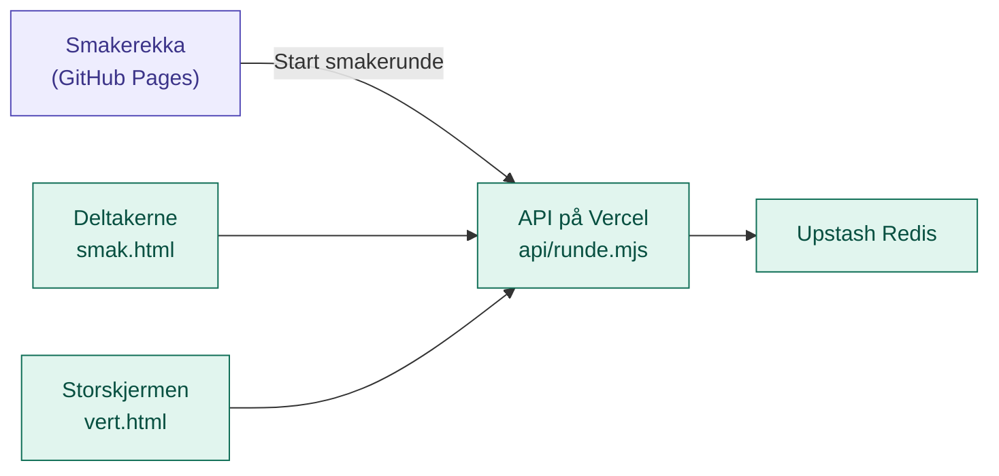

# Task 005: Smakerunde med rating

## Metadata

| Field | Value |
|-------|-------|
| Status | pending |
| Created | 2026-11-12 |
| Completed | - |
| Henger sammen med | [001](001-olsmaking-planlegger.md) (planleggeren), [004](completed/004-butikksok-alkoholfrie-og-juletema.md) |

## Kort fortalt

Fra smakerekka kan verten starte en smakerunde og får en kode og en lenke. Kollegene blir med på mobilen
med et kallenavn og gir hvert øl 1 til 5 stjerner i halve steg. Storskjermen oppdateres mens folk rater:
snitt per øl, kontorets favoritt, mest omstridt og hvordan dere slår Untappd. Verten velger blind eller vanlig;
blind viser bare «Øl 1», «Øl 2» til avslutningen. API-et er et eget Vercel-prosjekt, siden blir på GitHub
Pages, og rundene ligger i lunsjprosjektets Upstash i sju dager. Resultatet kan skrives ut eller lagres som
bilde. QR-kode og innlogging er utenfor. Rundt 1,75 timer.

## Utgangspunktet

Siden er statiske filer på GitHub Pages, uten noe sted å lagre karakterer. Lunsjprosjektet
(`~/src/felleslunsj`) kjører på Vercel med Upstash Redis via Vercel Marketplace og har mønstrene vi
trenger: lageret med en minneversjon lokalt og i tester (`src/lib/store.ts`), 1 til 5 stjerner i halve steg
(`src/lib/ratings.ts`), polling som stopper når fanen er skjult (`src/lib/client.ts`), og en admin-nøkkel som
sammenlignes i konstant tid (`src/lib/auth.ts`).

| Gratisnivå | |
|---|---|
| Upstash Redis | 500 000 kommandoer og 10 GB trafikk i måneden, 250 MB, én gratis database per konto |
| Vercel Hobby | 1 million funksjonskall, 4 timer CPU og 360 GB-timer minne i måneden, bare ikke-kommersielt |

En runde med 15 personer, 10 øl og 90 minutter, der storskjermen spør hvert femte sekund og deltakerne
hvert 20. sekund i den siste timen mens de venter: rundt 6 500 Redis-kommandoer og 4 000 funksjonskall.
Det gir plass til rundt 75 runder i måneden, delt med det lunsjprosjektet bruker.

## Description

### 1. API på Vercel

- API-et er et eget Vercel-prosjekt fra dette repoet. Siden blir på GitHub Pages.
- Én funksjon, `api/runde.mjs`, med Web-standard `Request` og `Response`, som ruter selv. En rewrite i
  `vercel.json` sender `/api/runde/*` dit. Funksjonen kan importeres uten Vercel, så testene kaller den
  direkte. Ingen pakker: Upstash nås med REST-API-et og `fetch`, med `KV_REST_API_URL` og
  `KV_REST_API_TOKEN` som i lunsjprosjektet.
- Rundene ligger i samme Upstash-database som lunsjprosjektet, koblet til det nye Vercel-prosjektet via
  Marketplace. Alle nøkler har prefikset `olsmaking:`, og lageret rører aldri andre nøkler.
- Lageret har samme grensesnitt i minnet, brukt lokalt og i tester, og minneversjonen tar vare på levetiden
  så testene kan sjekke den. Uten Upstash-variabler på Vercel kaster lageret i stedet for å falle til minnet.
- Rutene:
  - `POST /api/runde`: lager en runde med en kopi av ølene i rekka (navn, type, stil, score, alkohol, volum,
    pris, varenummer, lenke) og om den er blind. Svarer med en kode på seks tegn uten forvekslbare tegn
    (ikke 0, O, 1, I) og en vertnøkkel, som er det verten bruker for å avsløre og avslutte.
  - `GET /api/runde/{kode}`: runden. I en blind runde som ikke er avsluttet, har hvert øl bare plassen sin.
    Med vertnøkkelen i en header får verten alt, også skjenkelista.
  - `POST /api/runde/{kode}/deltaker`: kallenavn inn, deltaker-id og deltakernøkkel ut. Deltakernøkkelen er
    det som gjør at bare du kan endre dine egne karakterer.
  - `PUT /api/runde/{kode}/karakter`: deltaker-id, deltakernøkkel, plass, 1 til 5 stjerner i halve steg og
    kommentar. En ny karakter på samme plass erstatter den gamle. Stengt etter at runden er avsluttet.
  - `GET /api/runde/{kode}/resultater`: antall, snitt og spredning per øl. Navn, Untappd-score, kallenavn og
    kommentarer først når runden er avsluttet eller avslørt, og i en åpen runde med en gang.
  - `POST /api/runde/{kode}/avslutt`: krever vertnøkkelen. Avslører en blind runde og stenger karakterene.
- Alle kan starte runder, men høyst 20 nye i timen og 100 aktive til sammen. Høyst 12 øl og 50 deltakere per
  runde, kallenavn høyst 30 og kommentar høyst 140 tegn. Nøklene lagres som hash og sammenlignes i konstant tid.
- Alle nøkler i Redis får levetid på sju dager ved hver skriving, så tiden regnes fra siste endring.
- CORS bare for `https://mariushagen.github.io`, og `http://localhost:8000` bare når den ikke kjører i
  produksjon. `OPTIONS` besvares for `POST` og `PUT`. Resultatene hentes uten egne headere, så pollingen
  ikke utløser ekstra forhåndskall.

### 2. Deltakersiden

- `site/smak.html#KODE`: kallenavn, så ølene i rekkefølge med stjerner og kommentarfelt. Karakteren lagres med
  en gang, og deltakernøkkelen huskes i `localStorage`, så man kan lukke og åpne igjen.
- I en blind runde står bare «Øl 1», «Øl 2». Etter avslutningen vises navn, egen karakter, kontorets snitt og
  Untappd side om side.
- Har man ratet alt, spør siden hvert 20. sekund etter avslutningen, ikke når fanen er skjult, og stopper når
  runden er avsluttet.

### 3. Storskjermen og hovedsiden

- «Start smakerunde» under smakerekka på hovedsiden, med valget blind eller ikke. Verten havner på
  `site/vert.html#KODE` med koden stort, lenken, skjenkelista og vertnøkkelen i `localStorage`.
- Hvert femte sekund mens fanen er synlig: antall som har ratet hvert øl og snittet som søyler. Untappd
  vises først etter avslutningen i en blind runde. Pollingen stopper når runden er avsluttet, eller tre timer
  etter start.
- Etter avslutningen: kontorets favoritt, det mest omstridte ølet (størst spredning), største overraskelse
  (størst forskjell mot Untappd), og hvem som var mest enig med Untappd.
- «Skriv ut» med egen utskriftsstil, og «Lagre som bilde», som tegner resultatet som et PNG-bilde i
  nettleseren. Da kan resultatet tas vare på etter at runden er slettet.
- Adressen til API-et står ett sted i sidene, med `http://localhost:8787` når siden kjører lokalt.

### 4. Lokal kjøring, docs og regler

- `tools/lokal-api.mjs` kjører funksjonen med minnelageret på port 8787, og `.claude/launch.json` får en
  oppføring for den.
- `docs/deploy.md` med oppsettet på Vercel, som i lunsjprosjektet: prosjekt fra repoet uten byggesteg og bare
  med `api/`, Upstash-tilkoblingen, variablene og en røyktest.
- Regelen om personvern i `CLAUDE.md` blir: hovedsiden sender ingenting om brukeren. Smakerunden lagrer
  kallenavn, karakterer og kommentarer hos Upstash til de slettes, og ingenting annet. Vi lagrer ikke
  IP-adresser selv, men Vercel og Upstash fører egne logger. README sier det samme, og at koden er det eneste
  som beskytter en runde.

### Utenfor

- QR-kode. Lenken deles i Teams eller Slack, og koden kan skrives inn.
- Innlogging og kontoer. Kallenavn holder for en kontorrunde.
- Statistikk på tvers av runder.

## Acceptance Criteria

- [ ] API-testene i `tests/` kjøres av `tools/verifiser.sh` og dekker: lage runde, bli med, gi og endre
  karakter, resultater, avslutning, grensene, at bare vertnøkkelen avslutter, at en deltaker bare kan endre
  sine egne karakterer, at karakterer avvises etter avslutningen, og at alle nøkler har prefikset
  `olsmaking:` og levetid
- [ ] En blind runde svarer bare med felter fra en tillatt liste før avslutningen, i alle ruter, og testen er
  sett feile på et bevisst brudd
- [ ] En test teller Redis-kommandoene i en simulert runde (15 personer, 10 øl, 90 minutter, storskjerm hvert
  5. sekund, deltakere hvert 20. sekund i den siste timen), og de er under 8 000
- [ ] Playwright lokalt mot `tools/lokal-api.mjs`, som et verktøy utenfor `verifiser.sh`: verten starter en
  blind runde, tre deltakere i hver sin nettleser rater, storskjermen oppdateres, og avslutningen viser
  navnene hos alle
- [ ] «Skriv ut» og «Lagre som bilde» prøvd i Chrome: bildet har alle ølene med snitt og Untappd
- [ ] Prøvd mot Vercel og Upstash med to telefoner
- [ ] Skjermbilder av deltakersiden i 360 px og storskjermen i 1280 px, lyst og mørkt tema
- [ ] `README.md`, `CLAUDE.md` og `docs/deploy.md` er oppdatert

## Notes

**Review**: API-et tar imot og lagrer data fra brukere, så `review-etter-risiko` gir det en modell-review med
vekt på blindrunden, nøklene og grensene. Sidene: skjermbilder.

**Anslag** (netto, én utvikler med AI):

| Steg | Netto | Det som ikke krymper |
|---|---|---|
| 1 API, lager og tester | 0,5 t | Du lager Vercel-prosjektet og kobler til Upstash |
| 2 Deltakersiden | 0,25 t | |
| 3 Storskjermen, hovedsiden, utskrift og bilde | 0,75 t | |
| 4 Lokal kjøring, docs, Playwright og skjermbilder | 0,25 t | Test med to telefoner og noen kolleger |

Risiko: koden på seks tegn er det eneste som beskytter en runde, og grensene stopper misbruk fra nettlesere,
men ikke alt fra skript. Rundene deler database og kvote med lunsjprosjektet: brukes kvoten opp, stopper
begge til neste måned, og en feil i API-et kan i verste fall nå lunsjdataene. Prefikset og testen av det
holder dem adskilt.
