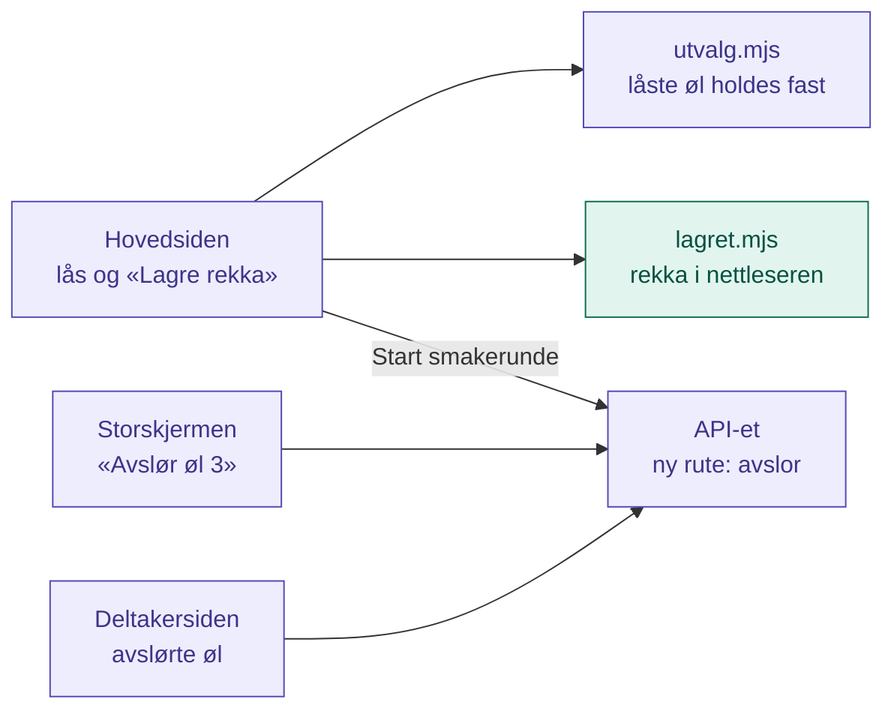

# Task 006: Lagre rekka, låse øl og avsløre øl for øl

## Metadata

| Field | Value |
|-------|-------|
| Status | in-progress |
| Created | 2026-11-13 |
| Completed | - |
| Henger sammen med | [005](005-smakerunde.md) (smakerunden, ikke prøvd på Vercel ennå), [001](001-olsmaking-planlegger.md) |

## Kort fortalt

Rekka kan lagres i nettleseren med alle opplysningene, så den er der uendret når dere smaker uker etter
innkjøpet, selv om et øl er utsolgt. Hvert øl kan låses, og bare resten velges på nytt når antall personer,
budsjett eller typer endres. I smakerunden avslører verten øl for øl: da låses karakterene for det ølet, og
navn, snitt og Untappd vises på storskjermen og hos alle. Før det viser storskjermen bare hvor mange som har
ratet. Tre småfeil fra skjermbildene rettes. Flere lagrede rekker er utenfor. Rundt 1 time.

## Utgangspunktet

- Lenken fra «Kopier lenke til rekka» har varenumrene (`ol` og `afol`), og `fraVarenumre` i
  `site/utvalg.mjs` henter de samme ølene fra dagens data. Et øl som ikke lenger finnes i
  `data/juleol.json`, faller stille ut, og øl som er solgt ut i butikken, merkes «Ikke nok på lager nå».
- Endrer man et valg, lager `velg` hele rekka på nytt. Den har én felles grense for hvor mange øl det kan være
  av hver type. «Bytt ut» bytter ett øl om gangen.
- I smakerunden henter storskjermen resultatene hvert 5. sekund uten vertnøkkel og viser kontorets snitt per
  øl hele tiden, i en blind runde bare med «Øl 1», «Øl 2». Deltakerne ser ingenting før verten avslutter,
  og spør bare etter avslutningen når de har ratet alt.

## Description

### 1. Låse øl

- Hvert øl i rekka, også de alkoholfrie, får en låseknapp ved «Bytt ut». Et låst øl er merket og har ikke
  «Bytt ut».
- `velg` tar imot de låste ølene som hele objekter, så de kan komme fra en lagret rekke selv om de mangler i
  dagens data. De låste er med uansett, prisen deres trekkes fra budsjettet, og bare de ledige plassene
  velges på nytt, blant øl som ikke er låst. Antall flasker regnes på nytt etter antall personer.
- Grensen per type gjelder hele rekka: utregningen får en egen grense for hver type, som er felles grense
  minus de låste av den typen. Er det låst flere av én type enn den felles grensen, heves grensen til det.
  Er alle plassene låst, er rekka de låste.
- Låste alkoholfrie er alltid med blant de alkoholfrie, og bare de ledige plassene går gjennom forsøkene med
  de beste og de billigste.
- Er det låst flere øl enn «Antall øl» eller flere alkoholfrie enn valgt, eller koster de låste mer enn
  budsjettet, sier siden det i klartekst i stedet for å regne ut en rekke.
- Et låst øl uten nok på lager blir stående med «Ikke nok på lager nå». Et låst øl som ikke finnes i dagens
  data, får «Finnes ikke lenger hos Polet» i stedet for lagertallet.
- Låsene står i lenken som varenumre (`las`), for rekka og de alkoholfrie samlet.
- Mangler øl fra en delt lenke i dagens data, sier boksen «Rekka kommer fra en delt lenke» også det («Ett øl
  fra lenken finnes ikke lenger hos Polet»), i stedet for at det forsvinner stille.

### 2. Lagre rekka i nettleseren

- Lagring og lesing ligger i en ny modul, `site/lagret.mjs`, uten tilgang til siden, så den testes med
  `node --test`: den bygger det som lagres, og leser det tilbake og avviser ødelagte eller ukjente data.
- «Lagre rekka» ved «Kopier lenke til rekka» lagrer valgene, låsene og hele rekka med alle opplysningene om
  hvert øl i `localStorage` under `olsmaking.rekke`, med datoen. Lagerstatus lagres ikke. Én lagret rekke per
  nettleser; å lagre igjen erstatter den.
- Kommer man til siden uten lenke og har en lagret rekke, vises den uendret: ølene kommer fra det som ble
  lagret, ikke fra dagens data, uten lagerstatus og uten «Bytt ut». Øverst står «Rekka di, lagret 13.
  november» og knappen «Lag ny rekke».
- Endrer man et valg, holdes de låste ølene fra det lagrede, og resten velges fra dagens data, med lager og
  «Bytt ut» som ellers. Øverst står da «Endret etter lagringen», med «Lagre rekka» og «Tilbake til den
  lagrede».
- «Start smakerunde» virker fra en lagret rekke som fra en vanlig.
- En lenke går foran en lagret rekke.

### 3. Avsløre øl for øl i smakerunden

Avsløringen gjelder både blinde og åpne runder: også i en åpen runde kommer snittet først når verten avslører
ølet.

API (`api/_lib/smakerunde.mjs`):

- Runden får en liste over avslørte plasser i runde-JSON-en. Ny rute `POST /api/runde/{kode}/avslor` med
  vertnøkkelen og plassen legger plassen til. Samme plass to ganger er greit. Uten riktig vertnøkkel 403,
  ukjent plass 400, avsluttet runde 409.
- Karakterer på et avslørt øl avvises med 409, som etter avslutningen.
- `visRunde` avgjør per øl: i en blind runde har et avslørt øl alle feltene, de andre bare plassen.
- `regnUt` avgjør per øl. Et øl som ikke er avslørt, har plassen og antall karakterer, og i en åpen runde også
  opplysningene om ølet (navn, type, Untappd), men aldri snitt, spredning eller karakterer. Et avslørt øl
  har alt, også karakterene med kallenavn og kommentar.
- Resultatene har alltid antall deltakere, hentet med `HLEN` i samme kall mot lageret.
- Avslutningen avslører alle plassene som ikke er avslørt. Sammendraget kommer bare ved avslutningen.

Storskjermen (`site/vert.html`):

- Navn og tall for avslørte øl kommer fra resultatene, som hentes hvert 5. sekund som før.
- Med vertnøkkelen: knappen «Avslør øl 3» for det neste ølet i rekkefølgen som ikke er avslørt. Har ikke
  alle deltakerne ratet det, sier knappen «2 har ikke ratet øl 3. Trykk igjen for å avsløre.» og venter på et
  trykk til. Avslutt-knappen heter «Avslutt runden» og avslører resten.
- Et øl som ikke er avslørt, viser «4 av 6 har ratet» og ingen søyle. Et avslørt øl får navnet, søylen med
  snitt og Untappd-streken.
- Kommentarene vises per avslørt øl under overskriften «Kommentarer».

Deltakersiden (`site/smak.html`):

- Spør etter runden hvert 30. sekund hele tiden mens fanen er synlig, og henter resultatene bare når et nytt
  øl er avslørt. Stopper når runden er avsluttet, eller etter tre timer.
- Stjernene låses per øl: et avslørt øl får navnet, «Du / Kontoret / Untappd» og låste stjerner. Avvises en
  karakter fordi ølet nettopp ble avslørt, sier siden det.

Kvoten: deltakerne spør hvert 30. sekund i stedet for hvert 20., fordi 20 sekunder hele runden gir rundt 8 800
kommandoer i Upstash. Med 30 sekunder og antall deltakere i resultatene blir det rundt 7 500 for 15 personer,
10 øl og 90 minutter, og testen som teller kommandoene, skal fortsatt være under 8 000. Det gir rom for rundt
65 runder i måneden, delt med lunsjprosjektet.

### 4. Tre småfeil fra skjermbildene

- Deltakersiden: ingressen øverst står med instruksen om stjernene også etter avslutningen. Den skal da bare si
  antall øl og om de ble smakt blindt.
- Storskjermen: kommentarene får overskriften «Kommentarer» (se steg 3).
- Utskriften: lenken og linja over koden skrives i mørk farge, så de synes på hvitt papir.

### 5. Docs

- `README.md`: rekka kan lagres og låses, og smakerunden avsløres øl for øl. Setningen om at storskjermen
  viser snittet mens dere smaker, rettes.
- `CLAUDE.md`: personvernregelen nevner at rekka også lagres i `localStorage`, og regelen om testen av
  tillatte felter i en blind runde gjelder hvert øl.
- `docs/deploy.md`: røyktesten får et kall til `/avslor`, og tallene for kvoten oppdateres.

### Utenfor

- Flere lagrede rekker, eller å flytte en lagret rekke mellom enheter. Lenken gjør det.
- Å avsløre øl i en annen rekkefølge enn rekka.
- To verter som avslører samtidig. Bare verten skriver runde-JSON-en, og et tap der betyr bare at et øl må
  avsløres på nytt. En karakter som er underveis i det verten avslører, kan komme med.

## Acceptance Criteria

- [x] Testene for `velg` dekker: låste øl er med når antall personer, budsjett og antall endres, de teller i
  grensen per type og i budsjettet, flere låste av én type enn grensen, alle plasser låst, et låst øl som
  mangler i dataene, låste alkoholfrie, og for mange eller for dyre låste øl gir en feilmelding. Testen for at
  låste øl er med, er sett feile på et bevisst brudd
- [x] Testene for `site/lagret.mjs` dekker: det som lagres, kommer uendret tilbake uten lagerstatus, og
  ødelagte data gir ingen lagret rekke
- [x] En lagret rekke vises uendret etter at et av ølene er fjernet fra dataene, prøvd med Playwright
- [x] API-testene dekker avsløringen: bare vertnøkkelen avslører, ukjent plass, avsluttet runde, karakter på
  et avslørt øl avvises, og avslutningen avslører resten
- [x] Testen av tillatte felter i en blind runde kjøres etter at ett øl er avslørt og sjekker hvert øl for seg
  i alle ruter: det avslørte har alt, de andre bare plassen, og bare plass og antall i resultatene. Testen er
  sett feile på et bevisst brudd
- [x] I en åpen runde har resultatene for et øl som ikke er avslørt, ikke snitt eller karakterer, og testen er
  sett feile på et bevisst brudd
- [x] Testen som teller kommandoene i en simulert runde, har den nye pollingen og avsløringene og er under
  8 000
- [x] Playwright lokalt: verten starter en blind runde, tre deltakere rater, verten avslører øl 1, og
  deltakerne ser navn og snitt bare for øl 1 og har låste stjerner der
- [x] Skjermbilder: hovedsiden med låste øl og med en lagret rekke i 360 px, storskjermen etter én avsløring i
  1280 px og deltakersiden med ett avslørt øl i 360 px, lyst og mørkt, pluss utskriften
- [x] De tre småfeilene er rettet og synes på skjermbildene og i utskriften
- [x] `README.md`, `CLAUDE.md` og `docs/deploy.md` er oppdatert

## Notes

**Review**: API-et endrer hva en blind runde viser, så `review-etter-risiko` gir det en modell-review med vekt
på hva som lekker før avsløringen, og vertnøkkelen på den nye ruten. `utvalg.mjs` og `lagret.mjs`: testene.
Sidene: skjermbilder.

**Anslag** (netto, én utvikler med AI):

| Steg | Netto | Det som ikke krymper |
|---|---|---|
| 1 Låse øl i utregningen og lenken | 0,25 t | |
| 2 Lagre rekka i nettleseren | 0,25 t | |
| 3 Avsløring i API-et og på sidene | 0,25 t | Test med telefoner på Vercel, sammen med testen i 005 |
| 4–5 Småfeil, Playwright, skjermbilder og docs | 0,25 t | Din gjennomgang av skjermbildene |

Risiko: låsene endrer utregningen som velger rekka, og den har en grense per type. En feil der gir en rekke
som bryter grensen eller budsjettet uten at noen ser det, og derfor sjekker testene begge. Avsløringen gjør
hva som er skjult i en blind runde, avhengig av hvert øl i stedet for hele runden, og det er der en lekkasje
kan komme.
