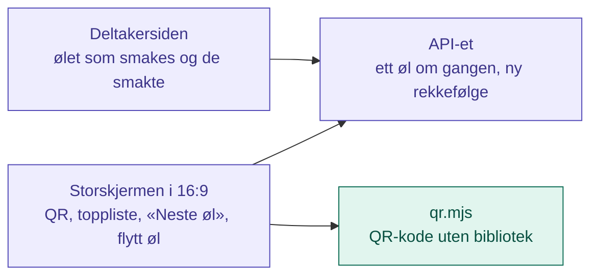

# Task 007: Ett øl om gangen, toppliste og storskjerm i 16:9

## Metadata

| Field | Value |
|-------|-------|
| Status | pending |
| Created | 2026-11-16 |
| Completed | - |
| Henger sammen med | [005](005-smakerunde.md) (smakerunden, ikke prøvd på Vercel ennå), [006](completed/006-lagre-rekka-og-avslor-ol-for-ol.md) (avsløring øl for øl) |

## Kort fortalt

Smakerunden går ett øl om gangen. Telefonene og storskjermen viser bare ølet som smakes og dem som er
smakt, og bare ølet som smakes, kan rates. Verten åpner første øl, og «Neste øl» avslører det som smakes og
åpner det neste. Verten kan flytte øl som ikke er åpnet, også de alkoholfrie. Storskjermen blir laget for en
skjerm i 16:9 uten rulling, med toppliste over avslørte øl og QR-kode for å bli med, skrevet uten bibliotek.
Vertsstyring fra egen telefon er utenfor. Rundt 1 time.

## Utgangspunktet

- Rekkefølgen i runden er rekka fra hovedsiden, fra lett til tungt, med de alkoholfrie sist
  (`site/index.html`, «Start smakerunde»). Den kan ikke endres etterpå.
- Deltakerne kan rate alle øl som ikke er avslørt, i hvilken rekkefølge de vil. I en åpen runde ser de
  navnene på alle ølene fra start, og det gjør storskjermen også.
- Verten avslører øl for øl med `POST /api/runde/{kode}/avslor`, og storskjermen viser alle ølene i
  rekkefølgen med «4 av 6 har ratet» til de er avslørt.
- Storskjermen (`site/vert.html`) er en side som ruller, høyst 72rem bred. Lenken og koden står øverst, men
  det finnes ingen QR-kode.

## Description

### 1. Ett øl om gangen i API-et

`api/_lib/smakerunde.mjs`:

- En ny runde er ikke startet: deltakerne kan bli med, men ingen øl er åpnet, og ingen kan rate.
- Ruten `avslor` erstattes av `POST /api/runde/{kode}/neste` med vertnøkkelen og plassen til ølet som smakes,
  eller 0 før første øl. Den avslører det ølet og åpner det neste. Etter det siste ølet er ingenting åpent, og
  runden venter på at verten avslutter. Samme plass to ganger gir 200 uten endring, så et dobbelttrykk eller to
  skjermer ikke hopper over et øl. En annen plass enn den som smakes, gir 409. Uten riktig vertnøkkel 403, og
  i en avsluttet runde 409.
- Karakter kan bare gis på ølet som smakes. Et øl som er avslørt eller ikke åpnet, gir 409 med en melding som
  sier hvilket.
- Hva som vises, avgjøres per øl ut fra plassen i rekkefølgen, i alle rutene uten vertnøkkel (`GET`,
  `deltaker` og `resultater`):
  - Et øl som ikke er åpnet: bare plassen, i både blind og åpen runde.
  - Ølet som smakes: i en blind runde plassen og antall karakterer, i en åpen også opplysningene om ølet.
  - Et avslørt øl: alt, som i dag.
- Ny rute `POST /api/runde/{kode}/rekkefolge` med vertnøkkelen og den nye rekkefølgen for ølene som ikke er
  åpnet, som en liste over plassene deres. Ølene får nye plasser etter den nye rekkefølgen. Lista må ha nøyaktig
  de ølene som ikke er åpnet, ellers 400. Ølet som smakes og de avslørte kan ikke flyttes, og de er de eneste
  som kan ha karakterer, så ingen karakter kan havne på feil øl. Uten riktig vertnøkkel 403, avsluttet 409.
- Avslutningen avslører alle ølene som før, også dem som ikke ble åpnet.

### 2. Deltakersiden

`site/smak.html`:

- Før første øl: «Verten åpner første øl snart», og hvor mange som har blitt med.
- Ølet som smakes står øverst og stort, med stjerner og kommentar. I en blind runde heter det «Øl 4».
- Under står de smakte ølene med navn, «Du / Kontoret / Untappd» og låste stjerner. Rakk man ikke å rate et
  øl før det ble avslørt, står det «Du rakk ikke å rate dette».
- Øl som ikke er åpnet, vises ikke, bare «3 øl igjen».
- Pollingen er som i dag: runden hvert 30. sekund og med en gang fanen blir synlig, så telefonen henter
  neste øl når skjermen låses opp. Resultatene hentes bare når et nytt øl er avslørt.

### 3. Storskjermen i 16:9

`site/vert.html`:

- Fra 1024 px bredde, liggende skjerm, fyller siden skjermen uten rulling mens runden pågår, med 12 øl:
  - Til venstre: ølet som smakes, stort, med «4 av 6 har ratet» og fremdriftsstreken. Under står vertens
    knapper.
  - Til høyre: topplista.
  - Øverst eller i et hjørne: koden, lenken og QR-koden.
  - Skriften skalerer med høyden på skjermen, så den kan leses på avstand.
  - Smalere eller stående skjerm: oppsettet fra i dag, med ølet som smakes øverst og topplista under.
- Før første øl: stor QR-kode og kode, hvor mange som har blitt med, og knappen «Åpne øl 1».
- Knappen heter «Neste øl» og har samme bekreftelse som i dag når noen ikke har ratet («2 har ikke ratet øl
  3. Trykk igjen.»). På det siste ølet heter den «Avslør øl 9», og etterpå blir «Avslutt runden» hovedknappen.
- Topplista har de avslørte ølene sortert på snitt, høyest først. Ved likt snitt kommer ølet med flest
  karakterer først, deretter rekkefølgen i runden. Hver rad har plass i lista, navn, søyle med snitt og
  Untappd-streken. Lista endres bare når et øl avsløres, siden snittet ikke finnes før det.
- Øl som ikke er åpnet, vises ikke på storskjermen, bare «3 øl igjen». Storskjermen står synlig for alle.
- Skjenkelista for verten får knapper for å flytte øl opp og ned, for øl som ikke er åpnet. Før første øl kan
  alle flyttes. I en blind runde viser skjenkelista navnene, så den åpnes på vertens egen skjerm.
- Etter avslutningen kan siden rulle: topplista er resultatet, og sammendraget og kommentarene kommer under.
  Utskrift og «Lagre som bilde» er som før.

### 4. QR-kode uten bibliotek

- `site/qr.mjs` lager en QR-kode for en tekst, i byte-modus med feilretting M, i den minste versjonen som
  har plass, opp til versjon 10. Den gir en SVG, så den er skarp på en stor skjerm. Ingen tilgang til siden,
  så den testes med `node --test`.
- QR-koden peker til samme lenke som «Kopier lenken».
- `tools/sjekk-qr.mjs` lager QR-koder for lenker av ulik lengde og lar macOS' egen QR-leser (Vision, via
  `swift`) lese dem. Den kjøres for hånd på en Mac, ikke i `verifiser.sh`.

### 5. Docs

- `README.md`: smakerunden går ett øl om gangen, verten kan flytte øl, og storskjermen har toppliste og
  QR-kode.
- `CLAUDE.md`: regelen om testen av tillatte felter gjelder også øl som ikke er åpnet, i både blind og åpen
  runde. `qr.mjs` nevnes under «Hvordan det henger sammen».
- `docs/deploy.md`: røyktesten bruker `/neste` i stedet for `/avslor`, og tallene for kvoten oppdateres.

### Utenfor

- Å styre runden fra vertens telefon mens storskjermen viser den. Vertnøkkelen ligger i nettleseren som
  startet runden.
- Å gå tilbake til et øl som er avslørt, eller å rate et øl man ikke rakk.
- Å endre rekkefølgen på hovedsiden. Utvalget bestemmer rekka og handlelista, og rekkefølgen i smakingen
  endres i runden.

## Acceptance Criteria

- [ ] API-testene dekker: ingen kan rate før første øl, bare ølet som smakes kan rates, `neste` bare med
  vertnøkkelen, samme plass to ganger åpner bare ett nytt øl, feil plass gir 409, og avslutningen avslører alt
- [ ] API-testene dekker flyttingen: bare vertnøkkelen, bare øl som ikke er åpnet, lista må ha nøyaktig de
  ølene, og karakterene for de smakte ølene står på samme øl etter en flytting
- [ ] Testen av tillatte felter kjøres for både blind og åpen runde, før start, midt i og etter siste øl, og
  sjekker hvert øl i alle ruter uten vertnøkkel. Den er sett feile på et bevisst brudd der et øl som ikke er
  åpnet, får navnet sitt
- [ ] Testen som teller kommandoene i en simulert runde, har start, `neste` og én flytting, og er under 8 000
- [ ] `node --test` for `qr.mjs` dekker størrelse, versjon og formatinformasjon, og `tools/sjekk-qr.mjs` leser
  QR-koder for fem lenker fra 20 tegn til den lengste lenken siden kan lage. Sjekken er sett feile på et
  bevisst brudd i feilrettingen
- [ ] Playwright lokalt: verten starter en blind runde, tre deltakere blir med, ingen kan rate før «Åpne øl 1»,
  verten flytter øl 5 foran øl 3, trykker «Neste øl» to ganger, og deltakerne ser bare de smakte ølene og det
  som smakes, i den nye rekkefølgen. Topplista er sortert på snitt
- [ ] Storskjermen ruller ikke under runden med 12 øl i 1920 × 1080, 1280 × 720 og 1440 × 900, målt med
  Playwright. Skjermbilder av dem og av deltakersiden i 360 px, lyst og mørkt
- [ ] `README.md`, `CLAUDE.md` og `docs/deploy.md` er oppdatert

## Notes

**Review**: API-et endrer hva som vises før et øl er åpnet og avslørt, og får en ny rute som flytter øl, så
`review-etter-risiko` gir det en modell-review med vekt på hva som lekker, vertnøkkelen på de nye rutene og
at karakterene blir stående på riktig øl. QR-koden: sjekken med macOS' QR-leser. Sidene: skjermbilder.

**Anslag** (netto, én utvikler med AI):

| Steg | Netto | Det som ikke krymper |
|---|---|---|
| 1 Ett øl om gangen og flytting i API-et | 0,25 t | |
| 2 Deltakersiden | 0,25 t | Test med telefoner på Wi-Fi |
| 3 Storskjermen i 16:9 med toppliste, Playwright og docs | 0,25 t | Test på en ekte TV, din gjennomgang av skjermbildene |
| 4 QR-kode med sjekk | 0,25 t | Skanning med en ekte telefon |

Risiko: flyttingen gir ølene nye plasser, og karakterene er lagret per plass. Derfor kan bare øl uten
karakterer flyttes, og en test sjekker at karakterene står på samme øl etterpå. En QR-koder med én feil bit
gir en kode som ikke kan leses, og det er sjekken med macOS' QR-leser som fanger det.

### Åpent

- Hvor endres rekkefølgen? Anbefalt: på storskjermen, for øl som ikke er åpnet, også midt i kvelden. Det
  andre er på hovedsiden før runden startes. Det er enklere i API-et, men rekkefølgen er da låst når runden
  er i gang.
- Skal runden starte med «Åpne øl 1»? Anbefalt: ja, så verten kan flytte alle øl før noen har ratet, og
  folk kan skanne QR-koden mens det skjenkes. Det andre er at øl 1 er åpent med en gang, og da kan det ikke
  flyttes.
