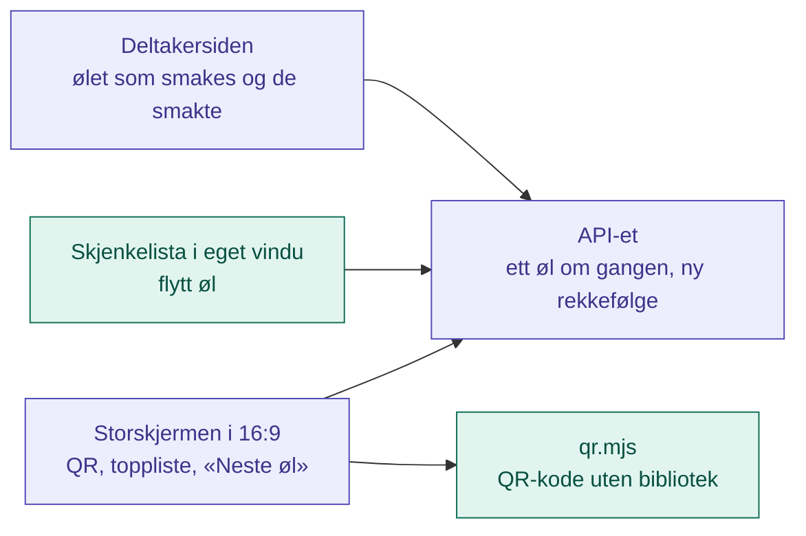

# Task 007: Ett øl om gangen, toppliste og storskjerm i 16:9

## Metadata

| Field | Value |
|-------|-------|
| Status | in-progress |
| Created | 2026-11-16 |
| Completed | - |
| Henger sammen med | [005](005-smakerunde.md) (smakerunden, ikke prøvd på Vercel ennå), [006](completed/006-lagre-rekka-og-avslor-ol-for-ol.md) (avsløring øl for øl) |

## Kort fortalt

Smakerunden går ett øl om gangen. Telefonene og storskjermen viser bare ølet som smakes og dem som er
smakt, og bare ølet som smakes, kan rates. Før «Start runden» viser storskjermen en QR-kode for å bli med, som
lages uten bibliotek. Etter start viser den «Øl 4 av 12», ølet som smakes, det sist avslørte med kommentarer og
en toppliste, i 16:9 uten rulling. «Neste øl» avslører det som smakes og åpner det neste, og verten kan flytte
øl som ikke er åpnet, også de alkoholfrie. Vertsstyring fra egen telefon er utenfor. Rundt 1 time.

## Utgangspunktet

- Rekkefølgen i runden er rekka fra hovedsiden, fra lett til tungt, med de alkoholfrie sist
  (`site/index.html`, «Start smakerunde»). Den kan ikke endres etterpå.
- Deltakerne kan rate alle øl som ikke er avslørt, i hvilken rekkefølge de vil. I en åpen runde ser de
  navnene på alle ølene fra start, og det gjør storskjermen også.
- Verten avslører øl for øl med `POST /api/runde/{kode}/avslor`, og storskjermen viser alle ølene i
  rekkefølgen med «4 av 6 har ratet» til de er avslørt. Runden har lista `avslort` med avslørte plasser.
- Storskjermen (`site/vert.html`) er en side som ruller, høyst 72rem bred. Lenken og koden står øverst, men
  det finnes ingen QR-kode. Skjenkelista for verten er en sammenlagt liste på samme side, og vertnøkkelen
  ligger i nettleseren som startet runden.

## Description

### 1. Ett øl om gangen i API-et

`api/_lib/smakerunde.mjs`:

- Runden får feltet `startet`. En ny runde er ikke startet: deltakerne kan bli med, men ingen øl er åpnet, og
  ingen kan rate. Når runden er startet, er ølet som smakes det første som ikke er avslørt. Runder uten
  feltet, fra før denne endringen, regnes som startet. De finnes bare lokalt.
- Ruten `avslor` erstattes av `POST /api/runde/{kode}/neste` med vertnøkkelen og plassen til ølet som smakes,
  eller 0 for å starte. Den avslører ølet og åpner det neste. Etter det siste ølet er ingenting åpent, og
  runden venter på at verten avslutter. Regelen for plassen:
  - Ølet som smakes, eller 0 i en runde som ikke er startet: avslør og åpne neste, eller start.
  - Et øl som allerede er avslørt, eller 0 i en startet runde: 200 uten endring, så et dobbelttrykk eller to
    skjermer ikke hopper over et øl.
  - Et øl som ikke er åpnet: 409. Uten riktig vertnøkkel 403, i en avsluttet runde 409.
- Karakter kan bare gis på ølet som smakes. Før start, på et avslørt øl eller på et øl som ikke er åpnet, gir
  det 409 med en melding som sier hvilket.
- Hva som vises, avgjøres per øl ut fra plassen i rekkefølgen, i alle rutene uten vertnøkkel (`GET`,
  `deltaker` og `resultater`):
  - Et øl som ikke er åpnet: bare plassen, i både blind og åpen runde.
  - Ølet som smakes: i en blind runde plassen og antall karakterer, i en åpen også opplysningene om ølet.
  - Et avslørt øl: alt, som i dag.
  - Toppnivået får `startet` og `na` (ølet som smakes) i tillegg til feltene i dag.
- Ny rute `POST /api/runde/{kode}/rekkefolge` med vertnøkkelen og den nye rekkefølgen for ølene som ikke er
  åpnet, som en liste over plassene deres. Ølene får nye plasser etter den nye rekkefølgen. Lista må ha nøyaktig
  de ølene som ikke er åpnet, ellers 400. Ølet som smakes og de avslørte kan ikke flyttes, og de er de eneste
  som kan ha karakterer, så ingen karakter kan havne på feil øl. Uten riktig vertnøkkel 403, avsluttet 409.
  En flytting fra en gammel liste gir 400.
- Verten skriver runden fra to vinduer, storskjermen og skjenkelista. Runden skrives derfor bare hvis den er lik
  den som ble lest, med et lite skript i Redis (`SETT_HVIS_LIK` i `api/_lib/lager.mjs`, det eneste skriptet
  lageret slipper gjennom). Ellers svarer `neste`, `rekkefolge` og `avslutt` 409 «Prøv igjen», så en flytting
  aldri skriver over en avsløring. To trykk på «Neste øl» fra to skjermer i samme øyeblikk gir 200 på begge.
- Avslutningen avslører alle ølene som før, også dem som ikke ble åpnet.

### 2. Deltakersiden

`site/smak.html`:

- Før første øl: «Verten åpner første øl snart», og hvor mange øl det er. Hvor mange som har blitt med, står
  bare på storskjermen, siden telefonene ellers måtte spurt etter resultatene hver gang.
- Ølet som smakes står øverst og stort, med stjerner og kommentar. I en blind runde heter det «Øl 4».
- Under står de smakte ølene med navn, «Du / Kontoret / Untappd» og låste stjerner. Rakk man ikke å rate et
  øl før det ble avslørt, står det «Du rakk ikke å rate dette».
- Øl som ikke er åpnet, vises ikke, bare «3 øl igjen».
- Runden hentes hvert 30. sekund og med en gang fanen blir synlig, så telefonen henter neste øl når skjermen
  låses opp. Siden tegnes på nytt når runden er startet eller et nytt øl er åpnet, ikke bare når et øl er
  avslørt. Resultatene hentes bare når et nytt øl er avslørt.

### 3. Storskjermen i 16:9

`site/vert.html`:

- Fra 1024 px bredde, liggende skjerm, fyller siden skjermen uten rulling mens runden pågår, med 12 øl:
  - Til venstre: ølet som smakes, stort, med «4 av 6 har ratet» og fremdriftsstreken. Under står vertens
    knapper.
  - Til høyre: topplista.
  - Øverst: «Øl 4 av 12» i stort. Koden, lenken og QR-koden vises bare før start, og etter start kan man bare
    bli med på lenken verten deler, for eksempel i chatten. Verten har «Kopier lenken» blant knappene.
  - Under ølet som smakes: det sist avslørte ølet med navn, snitt, Untappd, antall karakterer og høyst fire
    kommentarer.
  - Skriften skalerer med høyden på skjermen, så den kan leses på avstand.
  - Smalere eller stående skjerm: ett felt under et annet, med ølet som smakes øverst og topplista under.
- Før start: stor QR-kode, koden og lenken, hvor mange som har blitt med, og knappen «Start runden», som
  åpner øl 1.
- Knappen heter «Neste øl». Har ikke alle ratet ølet som smakes, sier den «2 har ikke ratet øl 3. Trykk igjen
  for å gå videre.» og venter på et trykk til. På det siste ølet heter den «Avslør øl 9», og etterpå blir
  «Avslutt runden» hovedknappen.
- Topplista har de avslørte ølene sortert på snitt, høyest først. Ved likt snitt kommer ølet med flest
  karakterer først, deretter rekkefølgen i runden. Et avslørt øl uten karakterer står sist med «–». Hver rad
  har plass i lista, navn, søyle med snitt og Untappd-streken. Lista endres bare når et øl avsløres, siden
  snittet ikke finnes før det.
- Øl som ikke er åpnet, vises ikke på storskjermen, bare «3 øl igjen». Storskjermen står synlig for alle.
- Skjenkelista flyttes ut av storskjermen. Storskjermen får lenken «Skjenkeliste» (bare med vertnøkkelen), som
  åpner `vert.html#KODE/skjenk` i et eget vindu. Det vinduet har vertnøkkelen, siden det er samme nettleser,
  og viser bare ølene i rekkefølgen med navn og knapper for å flytte øl som ikke er åpnet opp og ned. Før
  første øl kan alle flyttes. Er TV-en en ekstra skjerm, står vinduet på vertens egen skjerm, så navnene ikke
  vises på TV-en i en blind runde. Vinduet henter runden når det får fokus, ikke med jevne mellomrom.
- Etter avslutningen kan siden rulle: topplista er resultatet, og sammendraget og kommentarene kommer under.
  Utskrift og «Lagre som bilde» er som før.

### 4. QR-kode uten bibliotek

- `site/qr.mjs` lager en QR-kode for en tekst, i byte-modus med feilretting M (det nest laveste av fire
  nivåer), i den minste versjonen som har plass, opp til versjon 6 (106 tegn). Lenken til deltakerne er rundt
  56 tegn på GitHub Pages. En lengre tekst gir en feil, og da vises lenken og koden uten QR-kode.
- Den gir både modulene som rader med 0 og 1 og en SVG, så koden er skarp på en stor skjerm. Ingen tilgang til
  siden, så den testes i `tests/qr.test.mjs`, som `tools/verifiser.sh` plukker opp av seg selv.
- QR-koden peker til samme lenke som «Kopier lenken».
- `tools/sjekk-qr.mjs` lager QR-koder for tekster som gir hver versjon fra 1 til 6, tegner modulene som et
  bilde med hvit kant rundt, og lar macOS' egen QR-leser (Vision, via `swift`) lese dem. Den kjøres for hånd
  på en Mac, ikke i `verifiser.sh`, og gjør ingen kall ut.

### 5. Docs og tekster

- `site/index.html`: teksten ved «Start smakerunde» sier at dere smaker ett øl om gangen og at resultatene
  kommer på storskjermen etter hvert øl.
- `README.md`: avsnittet om smakerunden skrives om til den nye flyten: åpne første øl, «Neste øl», flytte øl
  i skjenkelista, toppliste og QR-kode. Avsnittet om blindsmaking følger med.
- `CLAUDE.md`: regelen om testen av tillatte felter skrives om: et øl som ikke er åpnet, viser bare plassen i
  både blind og åpen runde, ølet som smakes viser i en blind runde bare plassen og antall, og ingen ser snitt
  eller karakterer før ølet er avslørt. `qr.mjs` nevnes under «Hvordan det henger sammen», og
  `node tools/sjekk-qr.mjs` under «Kommandoer».
- `docs/deploy.md`: røyktesten starter runden med `neste` og plass 0, rater øl 1 og kaller `neste` med
  plass 1, og teksten om den følger med. Tallet under «Bruken av kvoten» settes til det testen gir.

### Utenfor

- Å styre runden fra vertens telefon mens storskjermen viser den. Vertnøkkelen ligger i nettleseren som
  startet runden.
- Å gå tilbake til et øl som er avslørt, eller å rate et øl man ikke rakk.
- Å endre rekkefølgen på hovedsiden. Utvalget bestemmer rekka og handlelista, og rekkefølgen i smakingen
  endres i runden.

## Acceptance Criteria

- [x] API-testene dekker `neste`: ingen kan rate før start, bare ølet som smakes kan rates, bare vertnøkkelen
  kan gå videre, ølet som smakes går videre, et avslørt øl og 0 i en startet runde gir 200 uten endring (også
  etter det siste ølet), et øl som ikke er åpnet gir 409, avslutningen avslører alt, og to vinduer hos verten
  skriver ikke over hverandre. Testen for to vinduer er sett feile på et bevisst brudd
- [x] API-testene dekker flyttingen: bare vertnøkkelen, bare øl som ikke er åpnet, lista må ha nøyaktig de
  ølene, og karakterene for de smakte ølene står på samme øl etter en flytting
- [x] Testen av tillatte felter kjøres for både blind og åpen runde, før start, midt i og etter siste øl, og
  sjekker hvert øl i alle ruter uten vertnøkkel. Den er sett feile på et bevisst brudd der et øl som ikke er
  åpnet, får navnet sitt
- [x] Testen som teller kommandoene i en simulert runde med 15 personer, 10 øl og 90 minutter har start,
  `neste` og én flytting, og er under 8 000
- [x] `tests/qr.test.mjs` dekker størrelse, versjon og formatinformasjon, og `tools/sjekk-qr.mjs` får macOS'
  QR-leser til å lese en kode i hver versjon fra 1 til 6. Sjekken er sett feile på et bevisst brudd i
  feilrettingen
- [x] Playwright lokalt, som en engangssjekk som ikke sjekkes inn: verten starter en blind runde, tre deltakere
  blir med, ingen kan rate før «Start runden», telefonene får øl 1 uten at noe er avslørt, verten flytter øl 5
  foran øl 3 i skjenkelista, QR-koden og koden er borte etter start og hodet viser «Øl 1 av 12», verten trykker
  «Neste øl» to ganger, det sist avslørte ølet vises med kommentarene, og deltakerne ser bare de smakte ølene og det som
  smakes, i den nye rekkefølgen. Topplista er sortert på snitt
- [x] Storskjermen ruller ikke under runden med 12 øl og fire lange kommentarer på det sist avslørte i 1920 × 1080, 1440 × 900, 1280 × 720 og 1024 × 768,
  målt med Playwright. Skjermbilder av dem, av skjenkelista og av deltakersiden i 360 px, lyst og mørkt
- [x] `site/index.html`, `README.md`, `CLAUDE.md` og `docs/deploy.md` er oppdatert

## Notes

**Review**: API-et endrer hva som vises før et øl er åpnet og avslørt, og får en ny rute som flytter øl, så
`review-etter-risiko` gir det en modell-review med vekt på hva som lekker, vertnøkkelen på de nye rutene og
at karakterene blir stående på riktig øl. QR-koden: sjekken med macOS' QR-leser. Sidene: skjermbilder.

**Anslag** (netto, én utvikler med AI):

| Steg | Netto | Det som ikke krymper |
|---|---|---|
| 1 Ett øl om gangen og flytting i API-et | 0,25 t | |
| 2 Deltakersiden | 0,25 t | Test med telefoner på Wi-Fi |
| 3 Storskjermen i 16:9, skjenkelista, Playwright og docs | 0,25 t | Test på en ekte TV, din gjennomgang av skjermbildene |
| 4 QR-kode til versjon 6, med sjekk | 0,25 t | Skanning med en ekte telefon |

Risiko: flyttingen gir ølene nye plasser, og karakterene er lagret per plass. Derfor kan bare øl uten
karakterer flyttes, og en test sjekker at karakterene står på samme øl etterpå. En QR-koder med én feil bit
gir en kode som ikke kan leses, og det er sjekken med macOS' QR-leser som fanger det. Kvoten har lite luft
(7 431 av 8 000 i dag), men `neste` og flyttingen er få kall per runde.
