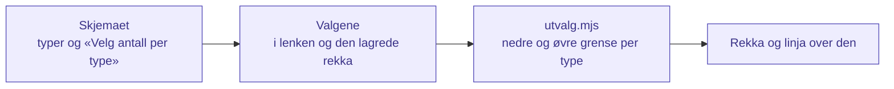

# Task 008: Jevn fordeling og antall per type

## Metadata

| Field | Value |
|-------|-------|
| Status | pending |
| Created | 2026-11-20 |
| Completed | - |
| Henger sammen med | [003](completed/003-velge-typer-og-mjod.md) (velge typer, høyst N per type) |

## Kort fortalt

Typene man krysser av, kommer med i rekka når det er minst like mange øl som typer, typen har øl i butikken
og budsjettet holder, og ølene fordeles så jevnt som mulig. Ellers sier siden hvilke som ikke kom med. Bak lenken
«Velg antall per type» kan man gi hver valgt type et fast antall, for eksempel to IPA og én mjød, mens
typene på «Auto» deler resten. Antallene står i lenken og i den lagrede rekka. Score og budsjett virker som
før. Rundt en halvtime, og Marius' gjennomgang kommer i tillegg.

## Utgangspunktet

`site/utvalg.mjs` har bare en øvre grense per type: antall øl delt på antall typer, rundet opp, og litt
høyere når andre typer har for få øl. Med ni typer og ti øl er grensen to. I Trondheim, Trondheim Torg, med
7 personer, 2 500 kr, 10 øl og alle typer unntatt «Lys og frisk» og «Gårdsøl og saison», ble det beste settet
to av hver av fem typer, uten IPA, bokk, klassisk juleøl og juleale. README lover at ølene fordeles «så jevnt
som mulig».

## Description

**Grenser per type.** `velg` regner ut en nedre og en øvre grense for hver valgt type, for hele rekka med de
låste øl:

- Fast antall: begge grensene er antallet, eller antallet låste av typen hvis det er flere.
- Auto: plassene som er igjen etter typene med fast antall og låste øl fra typer som ikke er valgt, deles
  på Auto-typene. Den nedre grensen er plassene delt på antall Auto-typer, rundet ned, men aldri mer enn
  typen har av øl her og låst. Den øvre grensen regnes som i dag med `maksPerGruppe`, over Auto-typene og
  plassene som er igjen, så de andre får flere når én type har for få øl. Med flere Auto-typer enn plasser
  er den nedre grensen null, og det beste settet velger hvilke typer som kommer med, som i dag.
- De låste av en type trekkes fra begge grensene før søket.

**Søket.** `besteSett` får en nedre grense per type i tillegg til den øvre. Det billigste mulige settet,
som gir «Det trengs minst … kr», tar de billigste ølene som de nedre grensene krever, og fyller resten med
de billigste innenfor de øvre. Går de nedre grensene for Auto-typene ikke opp med budsjettet, regnes rekka på
nytt uten dem, som i dag, og linja over rekka sier hvilke valgte typer som ikke kom med: «Budsjettet holdt
ikke til alle typene: Bokk og Juleale er ikke med.» Faste antall slippes aldri. `bytter` bytter innenfor
samme type og trenger ingen endring.

**Returverdien.** `velg` returnerer `grenser`, med `{ minst, hoyst }` per type, i stedet for `maksPerType`.
Testene som bruker `maksPerType`, skrives om til `grenser`, og `alleKombinasjoner` i testen for det beste
settet får nedre og øvre grense per type.

**Antall per type i skjemaet.** Under typene står lenken «Velg antall per type». Den åpner en liste over de
valgte typene, fra lett til tungt, med et felt hver: Auto, eller 1 til antall øl. Lista er lukket fra start,
og åpen når lenken eller den lagrede rekka har antall. Krysses en type av, forsvinner antallet, og «Fjern
alle» og «Velg alle» fjerner alle antall. Senkes antall øl under summen av de faste, står antallene, og
feilmeldingen sier hva som må endres.

**Feilmeldinger**, i samme tone som de andre:

- Faste antall som til sammen er flere enn antall øl: «Du har valgt 11 øl fordelt på typene, men 10 i alt.
  Velg flere øl, eller færre av en type.»
- Faste antall som er færre enn antall øl, uten noen type på Auto: «Typene gir 6 øl, men du har valgt 8.
  Velg flere av en type, eller sett en på Auto.»
- For få øl av en type her: «Bare 1 Mjød passer her. Velg færre av Mjød.»

**Lenken og lagringen.** Lenken får feltet `pt` med plassen i rekkefølgen og antallet, for eksempel
`pt=3:2,10:1`, bare når noen type har fast antall. `lesLenke` hopper over ukjente plasser og typer som ikke
er valgt, og holder antallet mellom 1 og antall øl, slik `t` og `tall()` gjør. `tilLagring` og `fraLagring`
i `site/lagret.mjs` tar med `perType`. En lagret rekke uten feltet er Auto for alle, og et `perType` som ikke
er et objekt med heltall fra 1 og opp, gir ingen lagret rekke, som andre ødelagte felt. `visLagret` filtrerer
`perType` mot typene i dataene, som den gjør med `typer`. Gamle lenker virker som før.

**Linja over rekka** regnes ut fra rekka selv, så den stemmer også for delte og lagrede rekker. Blant
Auto-typene som er med: «Én eller to av hver type.» når antallene er ulike, «To av hver type.» når de er
like og over én, og ingenting når det er én av hver. Har noen type fast antall, står det etter: «Fast antall:
Humle og IPA, Mjød.»

## Acceptance Criteria

- [ ] Eksempelet under «Utgangspunktet» har alle ni typene i testdataene (test)
- [ ] For mange kombinasjoner av typer, antall og budsjett har hver Auto-type et antall mellom nedre og
      øvre grense, og typer med fast antall akkurat det (test)
- [ ] Med faste antall og nedre grenser er valget fortsatt det beste settet: testen som prøver alle
      kombinasjoner i det lille datasettet, har nedre og øvre grense per type
- [ ] De tre feilmeldingene og «Det trengs minst … kr» med nedre grenser har tester
- [ ] Når den jevne fordelingen ikke går opp med budsjettet, kommer rekka uten noen Auto-typer, og
      `velg` sier hvilke (test)
- [ ] Låste øl teller i sin type, også når de er flere enn antallet (test)
- [ ] `perType` går gjennom lagringen, en lagret rekke uten feltet virker, og et ødelagt felt gir ingen
      lagret rekke (tester i `tests/lagret.test.mjs`)
- [ ] Testen for jevn fordeling er sett feile når den nedre grensen fjernes fra `besteSett`
- [ ] I nettleseren: `pt` i lenken gir de samme antallene etter ny lasting, og skjermbilder av skjemaet i
      360 og 1280 px, lyst og mørkt, med lista brukt fra tastaturet
- [ ] README, hjelpeteksten under typene og CLAUDE.md beskriver fordelingen og antall per type

## Notes

Review etter `review-etter-risiko`: utvalget med endrede tester og siden. Ingen endring i API-et eller
smakerunden.
