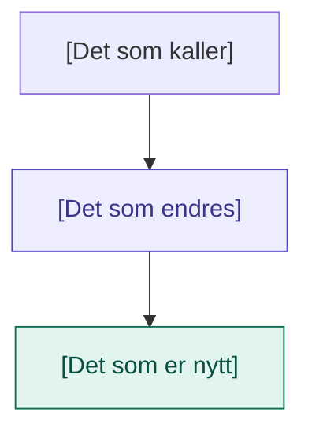

# Task XXX: [Title]

## Metadata

| Field | Value |
|-------|-------|
| Status | pending |
| Created | YYYY-MM-DD |
| Completed | - |

## Kort fortalt

[Høyst seks linjer: hva som legges til, hva som endres, hva som er bevisst utenfor, og omfanget. Det er
alt en leser trenger før detaljene. Oppdateres når planen endres.]

[Skissen viser lagene eller flyten tasken berører, med nytt og endret farget. Stryk den bare når det ikke
er noe å tegne, for eksempel når tasken rører én fil.]

## Description

[Hva som skal gjøres, i klarspråk, så en utvikler som ikke var med forstår det. Planen sier hva som skal
gjøres eller er gjort, ikke hvordan den ble til: ingen beslutningslogg og ingen historikk, git har den.
Parkert eller avgrenset stoff som er mer enn noen linjer, får en egen task.]

## Acceptance Criteria

- [ ] [Criterion 1]
- [ ] [Criterion 2]

## Notes

[Det en utvikler trenger i tillegg: docs som må oppdateres, estimat.]

### Åpent

[Spørsmål som må besvares før start. Svaret skrives inn i planen, og spørsmålet fjernes.]
