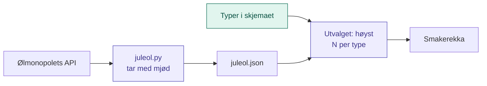

# Task 003: Velge typer, og mjød i utvalget

## Metadata

| Field | Value |
|-------|-------|
| Status | completed |
| Created | 2026-11-12 |
| Completed | 2026-11-12 |
| Henger sammen med | [001](../001-olsmaking-planlegger.md) (planleggeren) |

## Kort fortalt

Man velger hvilke typer (smaksgrupper) rekka skal hente fra, med alle valgt fra start. Velger man færre typer
enn antall øl, kommer det flere av hver type, fordelt så jevnt som mulig. Mjød er en egen type, valgt fra start
og lagt sist i rekka som dessert. Sider er fortsatt utenfor. Typene står i den delte lenken.

## Description

- `juleol.py` tar med hovedkategorien «Mjød» som egen gruppe, sist i rekkefølgen. Dagens data: 11 juleøl-mjøder,
  9 i Trondheim Torg.
- `site/utvalg.mjs` tar imot `typer`. Høyst ett øl per type når det er minst like mange typer som øl, ellers
  antall øl delt på antall typer, rundet opp, og litt flere der andre typer har for få øl. Det beste settet
  regnes fortsatt ut eksakt, nå med høyst så mange per type. Innenfor en type går rekka fra svakt til sterkt.
- `site/index.html` har en avkrysning per type og «Velg alle». Lenken har feltet `t` med plassene i
  rekkefølgen når ikke alle er valgt. Ingen valgte typer gir «Velg minst én type».

## Acceptance Criteria

- [x] Testene dekker: bare valgte typer er med; to typer og åtte øl gir fire av hver; mjøden kommer sist; og
  settet er det beste mot alle kombinasjoner med én, to og seks typer
- [x] Grensen per type er sett feile på et bevisst brudd (tre tester feilet uten den)
- [x] Prøvd i nettleseren: alle typer fra start, bare mørkt, ingen typer, «Velg alle» og en delt lenke
- [x] `README.md` og `CLAUDE.md` er oppdatert

## Notes

Med mjød valgt fra start får standardrekka for Trondheim Torg, fem personer og 1 500 kr nå en mjød til slutt.
