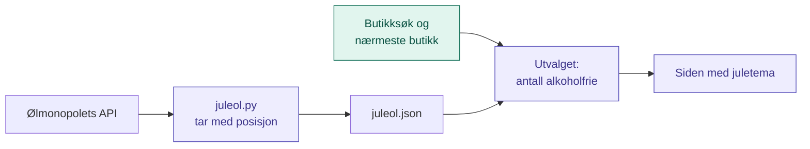

# Task 004: Butikksøk, alkoholfrie og juletema

## Metadata

| Field | Value |
|-------|-------|
| Status | completed |
| Created | 2026-11-12 |
| Completed | 2026-11-12 |
| Henger sammen med | [001](../001-olsmaking-planlegger.md), [003](003-velge-typer-og-mjod.md) |

## Kort fortalt

Siden starter uten butikk, husker den man valgte sist, og får et butikksøk som finner treff på by og navn
mens man skriver, med «Finn nærmeste butikk». Posisjonen blir i nettleseren. «Velg alle» typer blir
«Fjern alle» når alle er valgt. Man velger hvor mange alkoholfrie øl man vil ha, fra 0 til 4. Siden får et
juletema: mørkegrønt hode med julelys og snø, rødt og gull i detaljene. Å legge handlelista rett i
handlekurven hos Polet er utenfor.

## Description

### 1. Hentingen

- `juleol.py` legger posisjonen til hver butikk i `posisjon`, i samme rekkefølge som `butikker`. Den kommer
  fra `all_stock` i det samme kallet, så det blir ikke flere kall.

### 2. Utvalget

- `valg.alkoholfrie` er et antall. Utvalget tar de beste alkoholfrie som får plass i budsjettet, og bruker
  resten på rekka. Hvert alkoholfritt øl regnes som en smaksprøve for alle, som de andre.
- `valg.alkoholfritt: true` fra gamle lenker betyr ett.

### 3. Siden

- Butikksøket er et felt med en liste under: treff på by og navn, med «Bestill på nett» øverst. Piltaster,
  Enter og Escape virker, og lista følger mønsteret for kombinasjonsboks, så skjermlesere forstår den.
- «Finn nærmeste butikk» spør nettleseren om posisjonen og viser de fem nærmeste med avstand. Posisjonen
  sendes ingen steder.
- Uten butikk i lenken bruker siden butikken fra forrige besøk. Første gang sier den «Velg butikk eller
  bestill på nett», og viser ingen rekke.
- «Velg alle» typer blir «Fjern alle» når alle er valgt.
- Alkoholfrie velges med et antall fra 0 til 4. Lenken har antallet i `af` og varenumrene i `afol`.

### 4. Juletema

- Mørkegrønt hode over hele bredden, med en rad julelys som blinker rolig og snø som faller. Begge står
  stille når enheten ber om mindre bevegelse.
- Julerødt på hovedknappene og valgte typer, gull på score. Lyst og mørkt tema som før.
- Ingen eksterne fonter eller bilder.

### Utenfor

- Å legge handlelista rett i handlekurven hos Polet. Det finnes ingen åpen måte å fylle handlekurven fra en
  annen side, og handlekurven ligger i Polets egen innlogging.

## Acceptance Criteria

- [x] Testene for utvalget dekker antall alkoholfrie: rekka holder budsjettet med dem, og det kommer ikke
  flere enn det finnes
- [x] Testene for hentingen dekker at `posisjon` står i samme rekkefølge som `butikker`
- [x] Prøvd i nettleseren: første besøk uten butikk, søk på by og navn med tastatur, valgt butikk huskes,
  «Fjern alle» og «Velg alle», to alkoholfrie, og en delt lenke
- [x] Skjermbilder i 360 og 1280 px, lyst og mørkt tema

## Notes

**Review**: hentingen er endret, så `review-etter-risiko` gir den en modell-review. Siden: skjermbilder.
